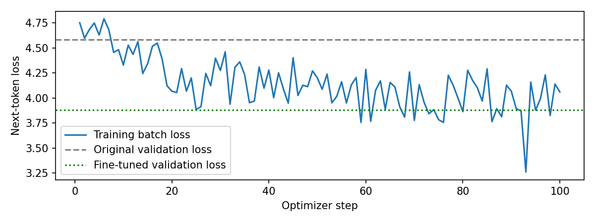

# DistilGPT2 fine-tuning on WikiText-2

**Caroline Meleka | October 2026**

A small language-model experiment using PyTorch and Hugging Face. I ran full fine-tuning of DistilGPT2, compared two learning rates using validation loss, and evaluated the selected setting on a separate test subset.

## Results

| Model | Validation loss | Validation perplexity | Test loss | Test perplexity |
|---|---:|---:|---:|---:|
| Pretrained baseline | 4.5826 | 97.77 | 4.8446 | 127.05 |
| Fine-tuned, learning rate `5e-5` | 3.8830 | 48.57 | 4.1043 | 60.60 |

Test perplexity decreased by **52.30%** on this subset. That is a prediction metric, not a factual-accuracy percentage.

## Method

- Model: `distilbert/distilgpt2`.
- Dataset: `Salesforce/wikitext`, configuration `wikitext-2-raw-v1`.
- Official train, validation and test splits were kept separate before tokenization.
- Nonempty lines were joined using end-of-text tokens and packed into 128-token blocks.
- Training pool: 512 blocks / 65,536 tokens. Each evaluation subset: 64 blocks / 8,192 tokens / 8,128 prediction targets.
- Seed 42; batch size 4; 100 updates; AdamW; weight decay 0.01; gradient clipping at norm 1.0.
- Each run processed 51,200 input-token presentations and 50,800 prediction targets, less than the entire training pool.
- Compared learning rates `5e-5` and `2e-5` with the same other settings. Validation losses were 3.8830 and 3.9169, respectively. The selected `5e-5` setting was rerun from the pretrained model before final testing.

The notebook and saved metrics retain the selected final run. The alternative learning-rate result was recorded during the earlier comparison; its separate checkpoint is not included.

## What did not improve reliably

The generated samples still repeat phrases and make unsupported historical and geographic claims. Better average next-token prediction did not make the model a reliable factual assistant. The evaluation uses small deterministic subsets, one seed and a short training budget. These scores are not full-WikiText benchmark results. Possible overlap with the model's original pretraining data was not assessed.

## Files

- [experiment.ipynb](experiment.ipynb): executed notebook with original code, real outputs, training logs and plot; teaching prompts and temporary widgets removed.
- [results.json](results.json): exact configuration, metrics, training history and generated samples from the final run.
- [environment.txt](environment.txt): installed package versions.
- [loss_curve.png](loss_curve.png): saved training and validation plot.



The full model checkpoint is stored separately from this lightweight project folder.

## Reproduction

Open the notebook in Google Colab with a GPU, install the listed packages, restart the runtime after package changes, and run the remaining code cells in order. The recorded run used Python 3.13.16, PyTorch 2.11.0+cu130, Transformers 5.20.2, Datasets 4.8.5 and a Tesla T4. CPU defaults use a smaller budget and are not directly comparable with these results. Exact bitwise reproducibility across hardware is not guaranteed.

The executed notebook resolves repository revisions at runtime. To repeat the exact source versions, use these hashes in the model and dataset loading configuration:

```text
Model:   2290a62682d06624634c1f46a6ad5be0f47f38aa
Dataset: b08601e04326c79dfdd32d625aee71d232d685c3
```

The test set was reserved for the configuration selected using validation. It should not be used to select further settings.

## Sources

- [DistilGPT2 model card](https://huggingface.co/distilbert/distilgpt2), model license Apache 2.0.
- [WikiText dataset card](https://huggingface.co/datasets/Salesforce/wikitext), dataset licenses CC BY-SA 3.0 / GFDL.
- [Causal language-model training guide](https://huggingface.co/docs/transformers/tasks/language_modeling).
- [PyTorch optimization tutorial](https://docs.pytorch.org/tutorials/beginner/basics/optimization_tutorial.html).
